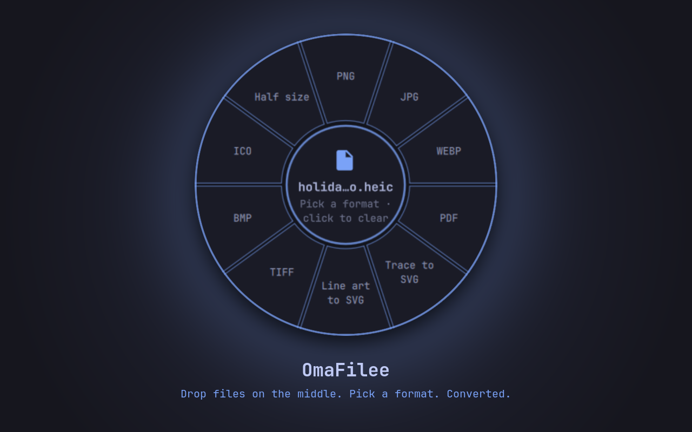

# OmaFilee

Drag, drop, converted, on Omarchy. OmaFilee puts
[Filee](https://github.com/KnifeLemon/Filee)'s donut converter on your desktop
in the Omarchy theme: drop files on the middle, pick a format from the ring
around it, and the converted files land next to the originals. Everything runs
offline on your machine.



> **Unofficial.** OmaFilee is a community front end for Filee. It is not made
> or supported by the Filee project; report problems here. See
> [NOTICE.md](NOTICE.md) for credits.

## Requirements

- **Omarchy 4** with shell plugins (tested on 4.0.5, Hyprland 0.56).
- **The Filee CLI** (`filee`), on `PATH` or at `~/.local/bin/filee`. OmaFilee
  doesn't include Filee; install it from a
  [Filee release](https://github.com/KnifeLemon/Filee/releases)
  (Linux x64 or ARM64, user-level, no root, needs Python 3):

  ```bash
  sha256sum -c Filee-<version>-linux-x64-SHA256SUMS.txt
  tar -xzf Filee-<version>-linux-x64.tar.gz
  ./Filee-<version>-linux-x64/install.sh
  ```

- **Optional engines** add formats. Filee uses them when they're installed:
  FFmpeg (video and audio), LibreOffice (office documents), Ghostscript
  (PostScript/EPS), Pandoc (extra markup) and calibre (e-books). On Omarchy:

  ```bash
  sudo pacman -S --needed ffmpeg libreoffice-fresh ghostscript pandoc-cli calibre
  ```

## Install

```bash
omarchy plugin add https://github.com/daniel-marr/omarchy-plugin-omafilee --enable
```

This adds a swap-arrows button to the right of your bar. Move it with
`omarchy bar move daniel-marr.omafilee --section <section>`.

## Use

| Action | What happens |
| --- | --- |
| Click the bar button | Opens the donut in the top-right corner, under the bar. Click again to close it; nothing else closes it. |
| Drop files on the middle | Filee's conversions for that file type fan out around the ring. |
| Click a slice | Converts the files. An arc spins round the ring while it works. |
| Drop files straight onto a slice | Converts in one go, like Filee's own drag gesture. |
| Click the empty middle | Opens a file picker instead of dragging. |
| Click the middle while files are loaded | Clears them. Right-click always clears. |
| Click the middle while converting | Cancels. |
| Click the middle when done | Opens the folder with the converted files. |
| **Super + drag** | Moves the donut, like any window. It returns to the top-right next time it opens. |

The donut follows you across workspaces and stays above other windows
(fullscreen apps still cover it). Files that fail stay loaded, so you can try
another slice; the reason shows in the middle.

### Which slices appear

The slices are Filee's own donuts, chosen by file type:

| Files | Slices |
| --- | --- |
| Images | PNG, JPG, WEBP, PDF, Trace to SVG, Line art to SVG, TIFF, BMP, ICO, Half size |
| PDF | PNG, JPG, Long image, DOCX, PPTX (slides), TXT, Markdown, EPUB, HWPX, HWP, Split PDF, Merge PDF |
| Documents | PDF, HWPX, HWP, DOCX, ODT, TXT, HTML, EPUB, PNG, Merge PDF |
| Spreadsheets | PDF, XLSX, CSV, JSON, ODS, HWPX, HWP, HTML, Merge PDF |
| Presentations | PDF, PNG, JPG, PPTX, HWPX, HWP, Merge PDF |
| Video | MP4, MP4 720p, MP4 HEVC, WEBM, MOV, GIF, MP3, Extract subtitles, MKV, AVI |
| Audio | MP3, MP3 128k, M4A, WAV, FLAC, OGG, OPUS, AAC |
| E-books, text, HWP, subtitles, vector, archives, CAD, fonts, data, 3D models | Filee's donut for each |
| A mix of types | PDF, Merge PDF, One ZIP, PNG, TXT |

**Custom donuts:** if you rearrange donuts in the Filee desktop app, it saves
them to `~/.config/Filee/profiles.json`, and OmaFilee uses that file instead
(it reloads when the file changes). Presets you edit in the app (quality,
resize, output name) apply too, because conversions go through Filee's own
presets.

### Scripting

Toggle the donut, or open it with files loaded and optionally convert straight
away with a preset id from `filee presets`:

```bash
omarchy-shell shell toggle daniel-marr.omafilee ''
omarchy-shell shell summon daniel-marr.omafilee '{"files":["/abs/a.heic","/abs/b.png"],"preset":"to-jpg","convert":true}'
```

Paths must be absolute; at most 200 files per call.

## What it changes on your system

- **Converted files** are written next to the originals by Filee. Existing
  files are kept (Filee adds a number). Nothing is uploaded.
- **Hyprland rules, at runtime only.** When the shell loads the plugin, it runs
  `hyprctl eval` to register rules that match only its own window
  (class `org.quickshell`, title `OmaFilee`): float, pin, no border, shadow or
  blur, don't take focus when opening, place top-right under the bar, and
  raise above other windows when focus changes. They're registered again after
  a Hyprland config reload. Your Hyprland config files are not edited.
- **Commands it runs:** `filee` (formats, presets, convert),
  `omarchy-file-select` (the file picker), `xdg-open` (open the output folder)
  and `hyprctl eval` (the rules above). File names are passed as arguments,
  never through a shell.

## Remove

```bash
omarchy plugin remove daniel-marr.omafilee
hyprctl reload    # drops the window rules straight away
```

Filee stays installed; remove it with the `uninstall.sh` in
`~/.local/share/filee/application/`.

## Troubleshooting

- **"Install the filee CLI"** in the middle: `filee` isn't on `PATH` or at
  `~/.local/bin/filee`. Check with `filee version`.
- **"Rename … (no * or ?)":** the Filee CLI treats `*` and `?` in a file
  name as wildcards, which could pick up other files in the same folder, so
  OmaFilee refuses those names. Rename the file and drop it again.
- **A slice fails with an engine error:** install the optional engine for that
  format (see Requirements).
- **The donut opens as a tiled window:** the runtime rules didn't register.
  `hyprctl repl 'return tostring(_G.omafilee_rules)'` should print
  `omafilee-2`; check the shell log with
  `quickshell log -p /usr/share/omarchy/shell | grep omafilee`.

## Development

```bash
./tests/run                 # manifest, unit tests and (on Omarchy) plugin validation
./scripts/dev-install.sh    # copy this checkout into ~/.config/omarchy/plugins and enable it
omarchy restart shell       # QML changes don't always hot-reload
```

`FileeModel.js` holds the pure logic (catalogue parsing, donut selection, hit
testing, result parsing), `Converter.qml` is the donut window and
`BarWidget.qml` is the bar button.

## License

MIT, see [LICENSE](LICENSE). Filee is MIT-licensed by Myeonggu Kim (KnifeLemon)
and the Filee contributors; see [NOTICE.md](NOTICE.md).
